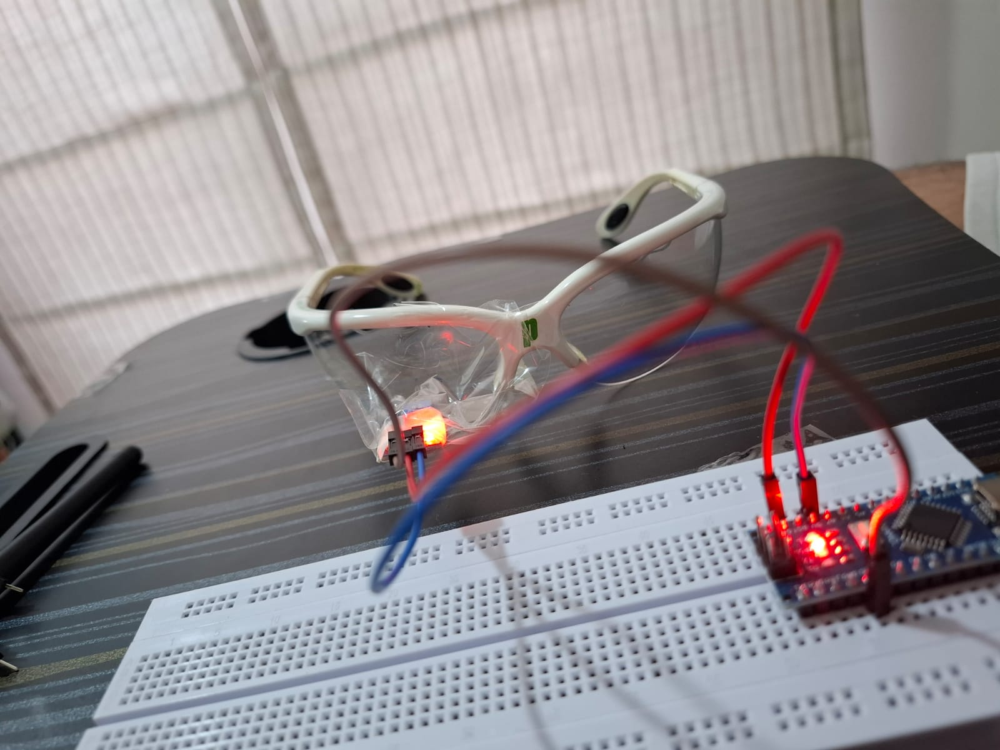
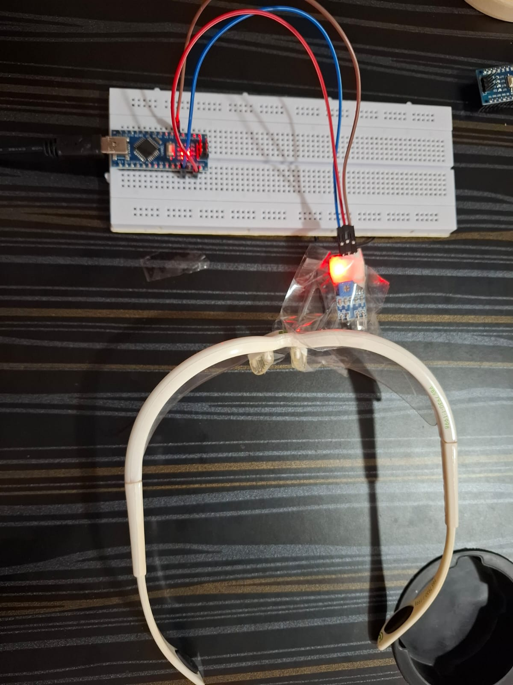

# 👁️ BlinkType: Eye-Blink Morse Code Glasses

An ultra-low-cost, camera-free Augmentative and Alternative Communication (AAC) wearable designed to translate intentional eye blinks into Morse code for individuals with severe motor paralysis (e.g., ALS, Locked-in Syndrome).

> **⚠️ Prototype Status:** This repository contains a **working MVP (Minimum Viable Product) prototype**. It is currently tethered to a laptop via USB for power and text output. 

---

## 🔊 System Output (What It Does)
The system uses an infrared sensor pointed at the eyelid to detect when the user intentionally closes their eye. Because it relies strictly on digital proximity sensing (`HIGH`/`LOW`), there are zero cameras, ensuring complete privacy.

* **Current Text Output:** The Arduino translates the user's short and long blinks into letters and words. Currently, it prints this translated text line-by-line directly to the laptop's Serial Monitor.
* **Audio Voice Upgrade:** The next iteration of this project will integrate a speaker system. Instead of just printing text to a screen, the hardware will audibly speak the translated letters and words out loud, giving the non-verbal user an independent, standalone voice.

---

## ⚙️ How the Logic Works (Arduino Firmware)
The system categorizes blink durations using custom timing thresholds:
1. **Natural Blink Filter (< 250 ms):** Completely ignored so the user can blink naturally to moisten their eyes.
2. **Dot (250 ms – 999 ms):** A deliberate, quick squeeze of the eye registers as a dot (`.`).
3. **Dash (1000+ ms):** A prolonged hold registers as a dash (`-`).
4. **Letter Timeout (2.25s idle):** Automatically decodes accumulated dots/dashes into a character.
5. **Word Space Timeout (5.0s idle):** Automatically inserts a space to transition to the next word, printing a clean, continuous sentence.

---

## 🛠️ Hardware Stack & Wiring

### Core Components (Current Prototype)
- **Microcontroller:** Arduino Nano
- **Sensor:** HW-201 Infrared Proximity Sensor
- **Wearable Base:** Safety Glasses
- **Breadboard & Jumper Wires**

### 🔊 Audio & Power Upgrades (Planned for V2)
To enable the standalone spoken audio output, the following components will be added:
- **Audio Decoder:** DFPlayer Mini MP3 Module
- **Speaker:** 8-Ohm, 2W Mini Speaker *(Best balance of small size and clear volume)*
- **Storage:** MicroSD Card *(To store the MP3 voice files)*
- **Portable Power:** 18650 Lithium-ion Battery & TP4056 Charging Module

### Pinout Guide (Current MVP)
| HW-201 IR Sensor | Arduino Nano Pin |
| :--- | :--- |
| **VCC** (Power) | 5V |
| **GND** (Ground) | GND |
| **OUT** (Signal) | Digital Pin 2 |

---

## 🚧 Development Challenges
Building this hardware prototype required precise manual tuning of the sensor alignment. Because infrared reflection depends heavily on angle and distance, positioning the HW-201 sensor on the glasses frame to achieve a reliable trigger—without placing the sensor too close to the eye—was a delicate balancing act. 

*(Future iterations will focus on a 3D-printed fixed mount to permanently solve the sensor angle alignment).*
